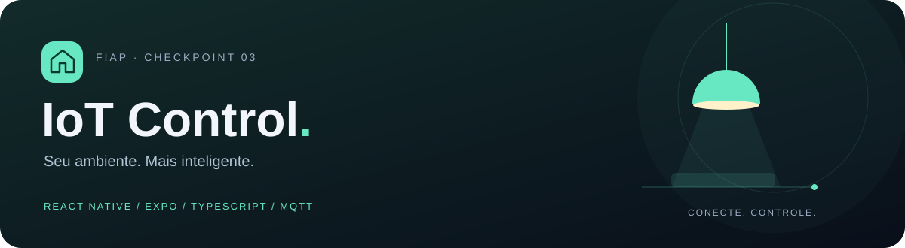
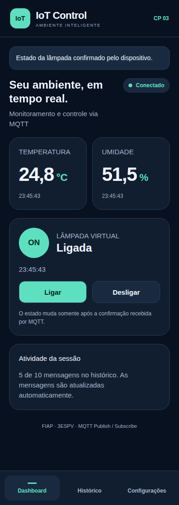
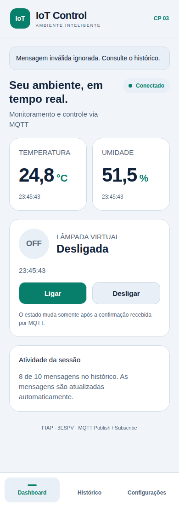
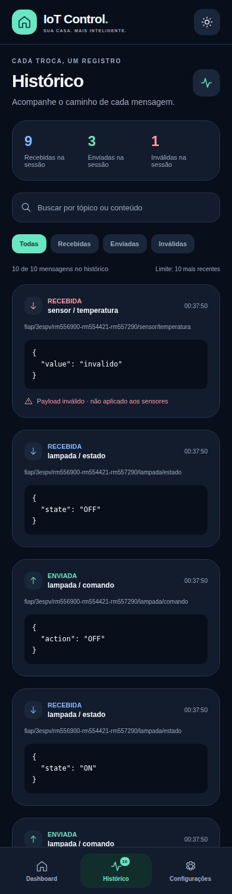
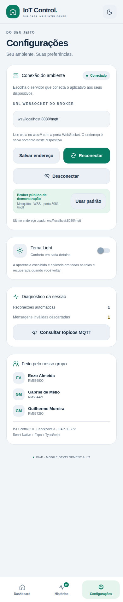
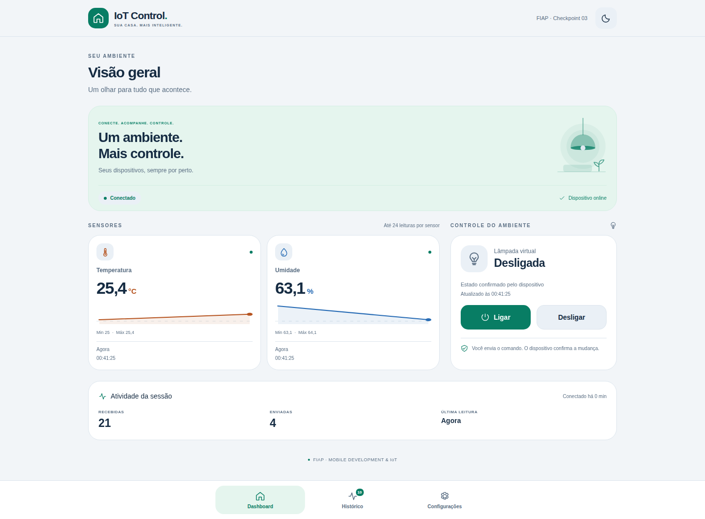
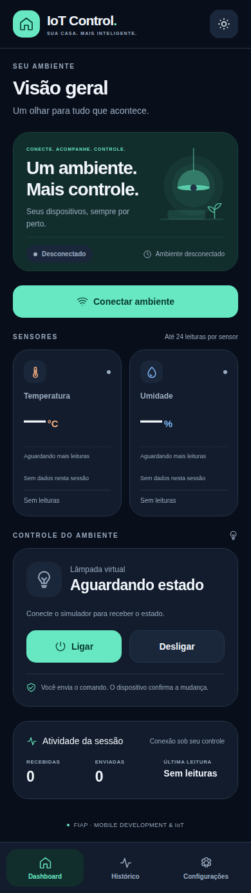

<p align="center"></p>

<p align="center">
  <a href="https://github.com/enzoalmeiida/iot-control-cp3/actions/workflows/verify.yml"></a>
  
  
  
</p>

# IoT Control · Checkpoint 3

Projeto desenvolvido para o **Checkpoint 3 da disciplina Mobile Development & IoT**, da turma **3ESPV da FIAP**. A aplicação utiliza React Native, Expo e TypeScript para monitorar temperatura e umidade e controlar uma lâmpada virtual por meio do protocolo MQTT.

O objetivo é demonstrar o modelo **publish/subscribe**, a comunicação em tempo real, a persistência de preferências locais e o gerenciamento do ciclo de vida de uma conexão MQTT. O dispositivo IoT é representado por um simulador incluído no repositório, dispensando hardware físico.

> O estado da lâmpada é atualizado exclusivamente a partir das mensagens recebidas no tópico de estado. A publicação de um comando não altera o estado visual antecipadamente.

## Integrantes

| Nome | RM |
| --- | --- |
| **Enzo Almeida** | **RM556900** |
| **Gabriel de Mello** | **RM554421** |
| **Guilherme Moreira** | **RM557290** |

**FIAP · 3ESPV · Mobile Development & IoT · Segundo semestre**

[Instalação e execução](#instalação-e-execução) · [Telas](#telas-da-aplicação) · [Tópicos MQTT](#contrato-de-mensagens) · [Testes](#qualidade-e-verificações) · [Arquitetura](docs/ARCHITECTURE.md)

## Funcionalidades implementadas

- **Dashboard:** temperatura, umidade, horários, gráficos das últimas 24 leituras, mínimos/máximos e controle confirmado da lâmpada.
- **Saúde do dispositivo:** diferencia conexão ao broker de telemetria ativa. Leituras sem atualização por mais de 10 segundos são marcadas como antigas.
- **Histórico:** as 10 mensagens mais recentes com direção, horário, tópico e JSON formatado; busca por conteúdo/tópico e filtros por direção ou validade.
- **Conexão resiliente:** reconexão automática, ação manual, cancelamento de tentativas, timeout de inscrição e cancelamento de envios pendentes.
- **Preferências:** endereço do broker e tema Light/Dark persistidos com AsyncStorage.
- **Interface:** ícones vetoriais, gráficos com dados recebidos, navegação acessível, estados vazios e avisos que podem ser fechados.
- **Simulação reproduzível:** dispositivo virtual e broker WebSocket local opcionais, incluídos no repositório.

## Instalação e execução

### Pré-requisitos

- **Node.js 20.19.4 ou superior**; a automação utiliza Node 22.
- npm e Git.
- Navegador, emulador ou ambiente Expo compatível com o SDK 54.

### Instalação

```bash
git clone https://github.com/enzoalmeiida/iot-control-cp3.git
cd iot-control-cp3
npm ci
```

### Execução

O simulador e o aplicativo são executados em terminais separados.

**Terminal 1 — dispositivo simulado:**

```bash
npm run simulator
```

**Terminal 2 — aplicativo:**

```bash
npm start
```

Após a inicialização, a aplicação pode ser acessada no Expo Go compatível, emulador ou navegador. A conexão é iniciada pela ação **Conectar ambiente** no Dashboard ou **Conectar** em Configurações. As leituras são recebidas automaticamente, e os controles **Ligar** e **Desligar** publicam os comandos da lâmpada.

| Comando | Uso |
| --- | --- |
| `npm start` | Abre o servidor de desenvolvimento Expo |
| `npm run android` | Abre em Android configurado |
| `npm run ios` | Abre no simulador iOS em macOS/Xcode |
| `npm run web` | Abre o alvo Web |
| `npm run simulator` | Inicia o dispositivo no broker público padrão |
| `npm run broker` | Inicia o broker WebSocket local |
| `npm run typecheck` | Confere os tipos TypeScript |
| `npm test` | Executa testes de protocolo, serviço, filtros e telemetria |
| `npm run test:mqtt` | Testa o ciclo MQTT contra um broker local aberto |

**Compatibilidade mobile:** a execução em aparelho físico requer uma versão do [Expo Go compatível com SDK 54](https://expo.dev/go) ou um development build compatível, além de conectividade entre o aparelho e o computador. O simulador iOS depende de macOS e Xcode. A validação realizada abrange a exportação dos bundles Android/iOS e os testes interativos da versão Web; não inclui execução em aparelho físico.

## Telas da aplicação

As capturas apresentam a versão Web em viewport de celular, executada com o broker e o simulador do projeto. As imagens são geradas pela automação após a execução dos testes de interface.

| Dashboard · Dark | Dashboard · Light |
| --- | --- |
|  |  |

| Histórico · Dark | Configurações · Light |
| --- | --- |
|  |  |

<details>
<summary>Layout desktop e estado inicial</summary>





</details>

### Dashboard

Gráficos e indicadores utilizam somente mensagens válidas recebidas. São armazenadas até 24 amostras por sensor durante a conexão. A lâmpada exibe o último estado recebido, identifica quando ele está antigo e aguarda até 8 segundos pela confirmação de um comando.

### Histórico

Armazena até 10 mensagens, preservando as mais recentes entre as recebidas e publicadas durante a sessão. Os filtros não apagam os registros. Os contadores de diagnóstico somam toda a sessão, portanto podem ser maiores que 10. Mensagens inválidas aparecem no histórico, mas não substituem os sensores.

### Configurações

Permite validar e salvar o endereço do broker, conectar, desconectar e alternar o tema. Apresenta diagnóstico de reconexões, referência dos tópicos e identificação do grupo. A ação **Usar padrão** preenche a URL do broker público; sua aplicação ocorre por meio de **Salvar endereço** ou **Conectar**.

## Broker padrão

```text
wss://test.mosquitto.org:8081/mqtt
```

| Campo | Valor |
| --- | --- |
| Host | `test.mosquitto.org` |
| Transporte | MQTT 3.1.1 sobre **WSS** |
| Porta | **8081** |
| Caminho | `/mqtt` |
| Autenticação | Sem usuário/senha |

**1883 e 8883 são portas MQTT TCP; não são as portas WebSocket usadas pelo app.**

O endereço pode ser alterado em Configurações. Aplicativo e simulador devem utilizar o mesmo broker e o mesmo conjunto de tópicos. A alternativa local descrita neste documento permite reproduzir a demonstração sem depender da disponibilidade do serviço público. Como os tópicos do broker público são acessíveis a outros clientes, ele é utilizado somente com dados simulados.

[Configuração publicada pelo Mosquitto](https://test.mosquitto.org/)

## Contrato de mensagens

Prefixo exclusivo: **`fiap/3espv/rm556900-rm554421-rm557290`**

| Tópico: prefixo + sufixo | Direção no app | Payload |
| --- | --- | --- |
| `/sensor/temperatura` | Subscribe | `{"value":24.5}` |
| `/sensor/umidade` | Subscribe | `{"value":58}` |
| `/lampada/comando` | Publish | `{"action":"ON"}` ou `{"action":"OFF"}` |
| `/lampada/estado` | Subscribe | `{"state":"ON"}` ou `{"state":"OFF"}` |

Exemplo completo: `fiap/3espv/rm556900-rm554421-rm557290/lampada/comando`.

- Sensores e estado são assinados com QoS 1.
- Comandos e telemetria são publicados com QoS 0, `retain: false`.
- A fila offline de comandos é desativada: comandos não ficam guardados para uma reconexão posterior.
- A confirmação de aplicação vem do tópico de estado; confirmação de envio não equivale a confirmação da lâmpada.
- Mensagens retidas podem ser exibidas como último estado, mas não confirmam um comando pendente.
- Temperatura aceita: −50 a 150 °C. Umidade: 0 a 100%. Exige JSON, número finito e ON/OFF em maiúsculas.
- Payloads maiores que 2.048 caracteres são rejeitados; o histórico limita sua exibição a esse tamanho.

## Execução com broker local

A execução local utiliza três processos em terminais separados, iniciados na pasta do projeto:

```bash
# Terminal 1 — broker local
npm run broker

# Terminal 2 — dispositivo no mesmo broker
npm run simulator -- --url ws://localhost:8080/mqtt

# Terminal 3 — app Web
npm run web
```

Na versão Web executada no mesmo computador, a URL configurada no aplicativo é **`ws://localhost:8080/mqtt`**, aplicada pela ação **Conectar**.

**Para acesso por celular físico**, o endereço utiliza o IP do computador no lugar de `localhost`, por exemplo `ws://192.168.0.10:8080/mqtt`. Ambos os dispositivos precisam ter conectividade pela rede. O broker local de desenvolvimento escuta na porta 8080 em todas as interfaces.

O simulador envia leituras a cada 2 segundos, inicia em OFF, confirma comandos imediatamente e ignora comandos retidos. Ctrl+C encerra o processo e seus timers. Os valores simulados variam de forma determinística; não representam medições físicas.

## Qualidade e verificações

A [automação do GitHub Actions](https://github.com/enzoalmeiida/iot-control-cp3/actions) executa:

1. Checagem TypeScript em modo strict.
2. Testes de protocolo, filtros, amostras e ciclo de vida da conexão.
3. Integração com broker real: sensores, comando ON/estado ON e comando OFF/estado OFF.
4. Exportação dos bundles **Android, iOS e Web**.
5. Testes da interface no Chromium: estado sem confirmação, payload inválido, dados antigos, queda do WebSocket, reconexão, filtros, persistência e layout estreito.
6. Capturas reais das telas, salvas no repositório após aprovação.

Os procedimentos de reprodução e os cenários de avaliação estão documentados em [Testes e roteiro de avaliação](docs/TESTING.md).

### Resultado da validação

A [execução de validação da versão 2.0](https://github.com/enzoalmeiida/iot-control-cp3/actions/runs/39522629990) foi concluída com sucesso:

| Verificação | Resultado |
| --- | --- |
| TypeScript strict | Aprovado |
| Testes automatizados de protocolo, serviço e utilitários | 13 aprovados; 0 falhas |
| Integração MQTT com sensores e confirmação ON/OFF | Aprovada |
| Exportação Android, iOS e Web | Concluída |
| Testes interativos da interface Web | Aprovados |
| Geração das capturas de tela | Concluída |

## Tecnologias

| Tecnologia | Versão configurada |
| --- | --- |
| Expo | SDK 54 (`~54.0.0`) |
| React Native | 0.81.5 |
| React / React DOM | 19.1.0 |
| TypeScript | ~5.9.2 · strict |
| MQTT.js | ^5.10.4 |
| AsyncStorage | 2.2.0 |
| React Native SVG | 15.12.1 |
| React Native Web | ^0.21.0 |
| Safe Area Context | ~5.6.0 |
| Node no CI | 22 |

O `package-lock.json` fixa as versões resolvidas. O app usa o bundle ESM de navegador do MQTT.js para evitar módulos TCP do Node; o simulador usa sua entrada Node. Não há credenciais privadas no projeto.

## Organização

```text
App.tsx                   Estrutura, navegação e avisos
src/
  components/             Design visual, ícones, gráficos e cartões
  context/IoTContext.tsx   Estado, persistência e confirmação de comandos
  hooks/                  Atualização de indicadores de tempo
  screens/                Dashboard, Histórico e Configurações
  services/
    mqttService.ts        Ciclo de vida MQTT independente da interface
    mqttClient.ts         Adaptador MQTT.js / WebSocket
    storageService.ts     AsyncStorage com gravações serializadas
  themes/                 Paletas completas Light/Dark
  types/                  Modelos tipados
  utils/                  Validação, filtros e métricas
scripts/                  Simulador, broker e verificações
tests/                    Testes automatizados
docs/                     Arquitetura, roteiro e capturas
```

[Arquitetura e decisões técnicas](docs/ARCHITECTURE.md)

## Limitações e configurações de execução

- O histórico e as amostras são mantidos em memória durante a sessão/conexão; somente URL e tema são persistidos.
- O usuário inicia a conexão. Ao voltar do segundo plano, o app tenta restabelecer uma conexão solicitada que esteja indisponível.
- Não há garantia de execução MQTT em segundo plano nem de entrega QoS 0. O último estado é preservado quando falta confirmação.
- Ao reiniciar o simulador, a lâmpada volta a OFF.
- O app não implementa autenticação de brokers privados e rejeita credenciais/tokens na URL.
- Em páginas HTTPS, a comunicação requer WSS para evitar bloqueio de conteúdo misto.
- O acesso ao broker depende da liberação da porta WebSocket e da conectividade da rede. O broker local constitui uma alternativa ao serviço público.
- A limpeza do cache do Expo pode ser realizada com `npx expo start --clear`; a verificação de dependências, com `npx expo-doctor`.
- As capturas demonstram a execução Web. Exportar os bundles nativos não substitui testar o app em um aparelho.

## Referência da atividade

[Enunciado do Checkpoint 3 — Mobile Development & IoT](https://github.com/anderltda/doc-react-native/blob/main/CPS/3ESPV/Segundo%20Semestre/README_TRABALHO_REACT_NATIVE_MQTT.md)
