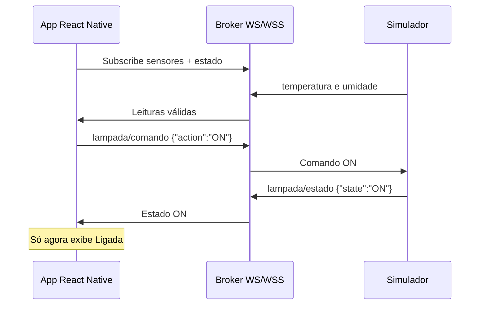

# Arquitetura do IoT Control

## Caminho de uma mensagem

## Responsabilidades

| Camada | Responsabilidade |
| --- | --- |
| Telas e componentes | Exibir o estado e oferecer ações acessíveis |
| IoTContext | Coordenar hooks, leituras, avisos, preferências e espera por confirmação |
| MqttService | Conectar, assinar, cancelar, publicar e descartar callbacks antigos |
| mqttClient | Adaptar MQTT.js ao contrato de transporte, com WebSocket |
| storageService | Recuperar preferências e serializar gravações do AsyncStorage |
| Utilitários | Validar payloads/URLs, limitar histórico/amostras e filtrar mensagens |
| Simulador | Reproduzir o dispositivo com sensores e estado da lâmpada |

A injeção de um transporte no MqttService permite testar falhas e callbacks atrasados sem depender de um broker externo. A integração e a interface também são verificadas contra um broker local real.

## Conexão e limpeza

Cada provider monta um único serviço. Uma nova conexão invalida a geração anterior; seus callbacks não podem atualizar o aplicativo. Os listeners do transporte anterior são removidos e o cliente é encerrado com sessão limpa.

A interface apresenta **conectando** até receber a confirmação da inscrição nos três tópicos. Se o broker não confirmar em 6 segundos, a conexão é encerrada com erro e ação de reconectar. Uma interrupção de rede ativa nova tentativa a cada 3 segundos.

Desconectar cancela a reconexão automática, rejeita envios pendentes e limpa timers. Ao desmontar o provider, também são removidos o listener de AppState e os timers de aviso/confirmacão.

## Confirmação de comandos

O serviço publica um JSON no tópico de comando. A interface passa a aguardar uma mensagem de estado com o valor correspondente e que não seja uma mensagem retida do broker.

- O toque e o callback de publicação **não** alteram o estado da lâmpada.
- Há timeout de 4 segundos para concluir a publicação.
- Há timeout de 8 segundos para receber o estado esperado.
- Sem confirmação, o último estado recebido permanece.
- Uma troca de conexão invalida resultados de comandos anteriores.
- Os controles ficam indisponíveis enquanto há um comando em andamento.
- Fora da conexão, o toque informa que é preciso conectar e não enfileira o comando.

O protocolo do CP não inclui identificador de correlação: uma mensagem de estado coincidente recebida após o comando satisfaz a confirmação, inclusive uma publicação periódica do dispositivo. Sistemas com múltiplos controladores podem adicionar requestId e confirmação correlacionada; isso não é implementado nesta entrega.

## Broker e dispositivo são estados diferentes

Uma conexão com o broker não demonstra que o dispositivo esteja enviando dados. O Dashboard exige temperatura e umidade válidas recebidas há no máximo 10 segundos para indicar **Dispositivo online**. Leituras mais antigas são identificadas como antigas mesmo com o broker conectado.

Os timestamps indicam a recepção no app, não o instante de medição de um sensor físico. Mensagens retidas representam o último dado armazenado pelo broker; não comprovam atividade recente do dispositivo.

## Dados mantidos

| Dado | Limite | Persistência |
| --- | --- | --- |
| Histórico misto | 10 mensagens | Memória da sessão |
| Tendências | 24 amostras por sensor | Memória da conexão |
| Contadores | Total da sessão | Memória |
| URL e tema | Preferências locais | AsyncStorage |
| Estado do simulador | Um estado ON/OFF | Memória do processo |

Payload inválido entra no histórico com marcação, mas não é aplicado aos sensores. Buscas e filtros não modificam os registros. Gravações de preferência são serializadas para reduzir condições de corrida em alterações rápidas de tema.

## Apresentação e acessibilidade

As duas paletas cobrem todas as telas. Os controles têm rótulos, áreas de toque e estados de seleção/desabilitado. Avisos e mudanças de conexão usam regiões de anúncio para leitores de tela. Gráficos incluem um resumo acessível com quantidade de leituras e mínimo/máximo; informações não dependem apenas de cor.

Ícones, ilustração e gráficos são vetores do próprio projeto. Nenhum gráfico fabrica amostras para preencher a interface. O layout usa StyleSheet e Flexbox, com adaptação para telas estreitas e desktop.
